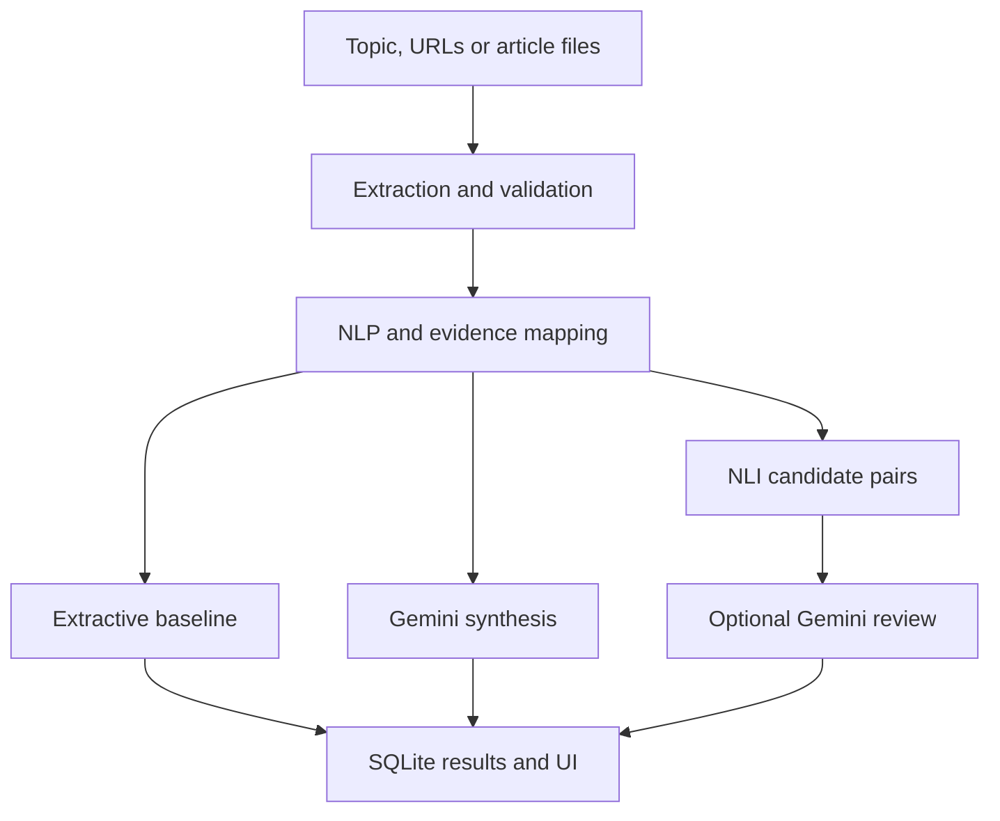

# ChronicleAI

Multi-document news analysis for an academic LLM + NLP demonstration. The approved dark frontend is preserved; FastAPI serves it locally with a modular Python pipeline.

## Quick start — Windows 11

Install **Python 3.11 (64-bit)** from python.org with the Python launcher enabled. Git is optional if you download this repository as a ZIP.

```powershell
git clone https://github.com/W2Viswajit/ChronicleAI.git
cd ChronicleAI
powershell -ExecutionPolicy Bypass -File .\setup.ps1
powershell -ExecutionPolicy Bypass -File .\start.ps1
```

Open **http://127.0.0.1:8000** after the server reports startup complete. The execution-policy flag applies only to that PowerShell process. Stop the server with Ctrl+C. No cloud hosting, Node.js, CUDA, or Colab is required.

### Start with the offline baseline

Click **Try a sample story**, review the four fictional articles, and click **Analyze articles**. Lightweight mode uses TF-IDF similarity, extractive sentence ranking, exact deduplication and dated-sentence extraction. NLI is explicitly marked not evaluated. Sources and results persist in `runtime/chronicle.sqlite3`.

### Enable Gemini

Setup creates `.env` from `.env.example` only if it does not already exist. Edit `.env` in VS Code or Notepad:

```dotenv
GEMINI_API_KEY=your_key_here
GEMINI_MODEL=gemini-2.5-flash
```

Choose an available structured-output model from your Google AI Studio project if the example model is unavailable. Restart the app. Gemini receives the selected article evidence; this mode requires internet and available API quota. Never commit `.env`, share the key, or place it in frontend code. Quota/auth/model errors fall back to a labeled extractive result.

### Enable full NLP and NLI on CPU

```powershell
powershell -ExecutionPolicy Bypass -File .\setup-models.ps1
```

Then set `NLP_MODE=models` in `.env` and restart. This installs CPU PyTorch, spaCy, sentence-transformers, and downloads:

- `en_core_web_sm` for sentence segmentation and entities.
- `sentence-transformers/all-MiniLM-L6-v2` for embeddings.
- `cross-encoder/nli-deberta-v3-small` for sentence-pair NLI.

Models download once and are cached. AMD Radeon acceleration is not required or configured. RAM and Ryzen generation were not specified: start lightweight, close unnecessary applications, and assess memory before full model mode. Model inference may be slow on CPU. One analysis runs at a time; at most three jobs are admitted. A model download/initialization failure is reported, never replaced with invented results.

### Other operating systems

```bash
python3.11 -m venv .venv
.venv/bin/pip install -r requirements.txt
cp .env.example .env
.venv/bin/python -m uvicorn backend.main:app --host 127.0.0.1 --port 8000
```

## Use the app

1. Add **2–10 articles** about one event. Search a topic, paste URLs, add text, or import TXT/CSV/JSON. CSV and JSON use `title`, `text`, `publisher`, `date`, and optionally `url`.
2. Review article previews and select sources. Search uses GDELT; `RSS_FEEDS` optionally enables a publisher RSS fallback. Discovery coverage is not exhaustive. GDELT discovery time is not treated as publication time. Respect publisher terms; paywalls are not bypassed.
3. Analyze. The UI displays job progress, then a briefing, event timeline, NLI results if enabled, article similarity matrix, clusters, named entities, and evaluation status.
4. Switch between the main briefing and extractive baseline. Each citation opens its original article.
5. Export JSON. Under **How it works → Load recent analyses**, reopen a saved result after a browser refresh.

The existing hosted frontend remains the earlier browser baseline; **run this local copy for the new Python backend**. This work does not redeploy that Site.

## Architecture



- **NLP:** sentence segmentation, TF-IDF; optional spaCy entities and embeddings; cosine article grouping; exact duplicate filtering; date resolution and pretrained NLI.
- **LLM:** schema-validated evidence-grounded summary/event extraction and review of up to five NLI flags.
- **Grounding:** stable sentence IDs, retained source mappings, rejection of invented citation IDs. Citation validity does not establish semantic entailment or truth.
- **Evidence budget:** round-robin selection across sources, capped by characters. This is bounded evidence selection, **not hierarchical all-document summarization**. Omitted sentence counts are visible.
- **Contradictions:** similar cross-source sentences are candidates, not fully decomposed atomic claims. Report-date and number differences generate review flags. Those heuristics do not resolve contradictions automatically.

## API

Interactive documentation: **http://127.0.0.1:8000/docs**.

| Endpoint | Purpose |
|---|---|
| `GET /api/health` | Service status |
| `GET /api/capabilities` | Configured modes; does not prove model readiness |
| `POST /api/articles/search` | GDELT search and accessible text extraction |
| `POST /api/articles/extract` | Extract up to ten public article URLs |
| `POST /api/analyses` | Queue a collection; returns job ID |
| `GET /api/analyses` | Recent saved jobs |
| `GET /api/analyses/{id}` | Status/result |
| `GET /api/analyses/{id}/export` | Download completed JSON |

Uploads are parsed in the frontend, then validated as articles by the analysis endpoint. No separate multipart-upload service is needed. The database marks interrupted jobs failed on restart; users can rerun them. This is a single-process local demo, not a distributed job queue. Do not use multiple Uvicorn workers.

## Evaluation and tests

```powershell
.\.venv\Scripts\python.exe -m pytest -q
```

Tests cover duplicate/provenance handling, preservation of numeric disagreements, relative dates, ambiguous dates, invalid citations, fallback behavior, URL validation, article parsing, job polling, persistence, and export. They use local fixtures/mocks, not a paid API.

To compute ROUGE using an actual reference summary:

```powershell
.\.venv\Scripts\python.exe -m scripts.evaluate chronicle-analysis.json reference.txt
```

Optional BERTScore downloads an additional model:

```powershell
.\.venv\Scripts\python.exe -m pip install bert-score
.\.venv\Scripts\python.exe -m scripts.evaluate chronicle-analysis.json reference.txt --bertscore
```

An illustrative hand-authored annotation file is provided at `data/annotations.json`. It is not a held-out benchmark. Timeline accuracy, contradiction F1, and semantic factual consistency remain **Not evaluated** until a separately labeled evaluation collection is supplied. Never present fictional demo examples as real reporting or benchmark performance.

## Verification status

- Core Python tests passed in a Linux Python 3.12 environment; Windows scripts target Python 3.11 and still require a run on the target laptop.
- Frontend JavaScript syntax and adapter rendering checked; no visual browser QA was available.
- Gemini SDK structured schema configuration checked; live inference needs your key.
- Full pretrained model inference is not validated in this environment. Run the model setup and sample on your laptop.
- External provider availability and publisher extraction are best effort; failed URLs are listed.

## Files

`backend/` contains config, schemas, extraction, NLP, Gemini, date processing, NLI, pipeline, persistence and API modules. `frontend/` contains the approved interface plus `backend.js`, its data adapter. `scripts/` contains model setup/evaluation helpers. `data/` contains fictional demonstration inputs. `tests/` contains functional tests.

## Limits and safety

This is a **local academic project**, not a production deployment. The Windows launcher binds to loopback. Do not expose it through a public tunnel: it has no user authentication or tenant isolation. URL validation blocks private addresses and revalidates redirects but is not a hardened public fetching proxy. A Dockerfile is included for optional local lightweight execution (`docker run -p 127.0.0.1:8000:8000 --env-file .env IMAGE`).

Inputs are English-only in this version. Relative-date extraction has limited coverage. Near-duplicate candidates are deliberately retained so conflicting facts are not erased; semantic deduplication remains a review stage. NLI probabilities are uncalibrated model scores. Gemini may still misinterpret evidence. There is no automatic truth judgment, independent fact verification, complete news coverage, LLM-only benchmark, or calibrated model confidence claim.

To delete local records, stop the application and remove `runtime/`. Source-extraction cache entries are reused for six hours. Hugging Face model caches live separately in your user profile.
